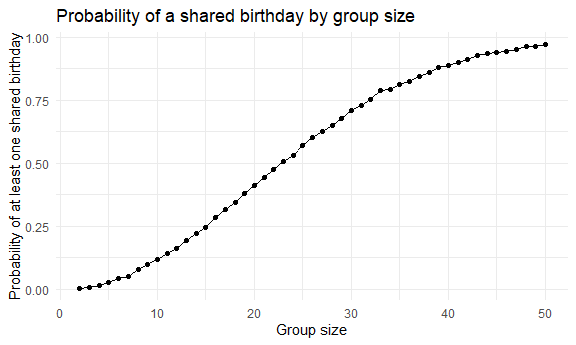

p8105_hw5_qc2385
================
Qixuan Cao
2026-11-15

``` r
library(tidyverse)

set.seed(1236)
```

## Problem 1

Write a function that draws birthdays for a group and checks for
duplicates.

``` r
birthday_repeated = function(n_people) {

  if (!is.numeric(n_people)) {
    stop("n_people must be numeric")
  } else if (n_people < 2) {
    stop("n_people should be 2 or more")
  }

  birthdays = sample(1:365, size = n_people, replace = TRUE)

  repeated = length(unique(birthdays)) < n_people

  repeated

}
```

Run it 10000 times for each group size between 2 and 50.

``` r
birthday_results_df =
  expand_grid(
    n_people = 2:50,
    iter = 1:10000
  ) |>
  mutate(
    repeated = map_lgl(n_people, birthday_repeated)
  ) |>
  group_by(n_people) |>
  summarize(prob_repeat = mean(repeated))
```

Plot the probability as a function of group size.

``` r
birthday_results_df |>
  ggplot(aes(x = n_people, y = prob_repeat)) +
  geom_point() +
  geom_line() +
  labs(
    title = "Probability of a shared birthday by group size",
    x = "Group size",
    y = "Probability of at least one shared birthday"
  )
```



The probability of a shared birthday increases quickly with group size.
It is close to 0 for very small groups, passes 50% at a group size of
23, and reaches about 97.1% with 50 people. Therefore, even a moderately
sized group is likely to have at least two people with the same
birthday.
