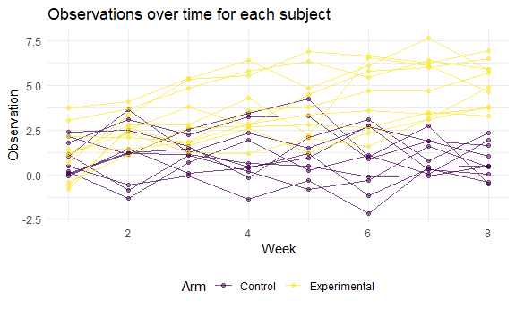

p8105_hw5_qc2385
================
Qixuan Cao
2026-11-15

``` r
library(tidyverse)

set.seed(1236)
```

## Problem 1

Write a function that draws birthdays for a group and checks for
duplicates.

``` r
birthday_repeated = function(n_people) {

  if (!is.numeric(n_people)) {
    stop("n_people must be numeric")
  } else if (n_people < 2) {
    stop("n_people should be 2 or more")
  }

  birthdays = sample(1:365, size = n_people, replace = TRUE)

  repeated = length(unique(birthdays)) < n_people

  repeated

}
```

Run it 10000 times for each group size between 2 and 50.

``` r
birthday_results_df =
  expand_grid(
    n_people = 2:50,
    iter = 1:10000
  ) |>
  mutate(
    repeated = map_lgl(n_people, birthday_repeated)
  ) |>
  group_by(n_people) |>
  summarize(prob_repeat = mean(repeated))
```

Plot the probability as a function of group size.

``` r
birthday_results_df |>
  ggplot(aes(x = n_people, y = prob_repeat)) +
  geom_point() +
  geom_line() +
  labs(
    title = "Probability of a shared birthday by group size",
    x = "Group size",
    y = "Probability of at least one shared birthday"
  )
```


The probability of a shared birthday increases quickly with group size.
It is close to 0 for very small groups, passes 50% at a group size of
23, and reaches about 97.1% with 50 people. Therefore, even a moderately
sized group is likely to have at least two people with the same
birthday.

## Problem 2

Start with a dataframe of all file names, then read in data for each
subject using map.

``` r
study_df =
  tibble(
    files = list.files("data/", pattern = "\\.csv$"),
    path = str_c("data/", files)
  ) |>
  mutate(data = map(path, read_csv)) |>
  unnest(data)
```

Tidy the result: get arm and subject ID from the file name, and make
weekly observations long.

``` r
study_tidy_df =
  study_df |>
  mutate(files = str_replace(files, "\\.csv", "")) |>
  separate(files, into = c("arm", "subject_id"), sep = "_") |>
  mutate(
    arm = if_else(arm == "con", "Control", "Experimental"),
    subject_id = str_c(arm, "_", subject_id)
  ) |>
  pivot_longer(
    week_1:week_8,
    names_to = "week",
    values_to = "observation",
    names_prefix = "week_"
  ) |>
  mutate(week = as.numeric(week)) |>
  select(arm, subject_id, week, observation)

study_tidy_df
```

    ## # A tibble: 160 × 4
    ##    arm     subject_id  week observation
    ##    <chr>   <chr>      <dbl>       <dbl>
    ##  1 Control Control_01     1        0.2 
    ##  2 Control Control_01     2       -1.31
    ##  3 Control Control_01     3        0.66
    ##  4 Control Control_01     4        1.96
    ##  5 Control Control_01     5        0.23
    ##  6 Control Control_01     6        1.09
    ##  7 Control Control_01     7        0.05
    ##  8 Control Control_01     8        1.94
    ##  9 Control Control_02     1        1.13
    ## 10 Control Control_02     2       -0.88
    ## # ℹ 150 more rows

Make a spaghetti plot showing observations on each subject over time.

``` r
study_tidy_df |>
  ggplot(aes(x = week, y = observation, group = subject_id, color = arm)) +
  geom_point(alpha = .5) +
  geom_line(alpha = .7) +
  labs(
    title = "Observations over time for each subject",
    x = "Week",
    y = "Observation",
    color = "Arm"
  )
```



The two arms start at similar levels in week 1 (mean 0.92 in control vs
1.14 in experimental). Subjects in the control arm stay roughly flat
over the 8 weeks (mean 0.74 at week 8), while subjects in the
experimental arm increase over time in a roughly linear way (mean 5.12
at week 8). Therefore, the experimental arm shows a clear upward trend
that the control arm does not.
